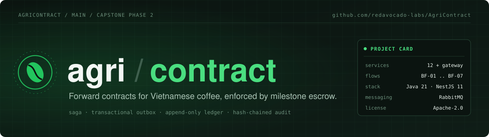
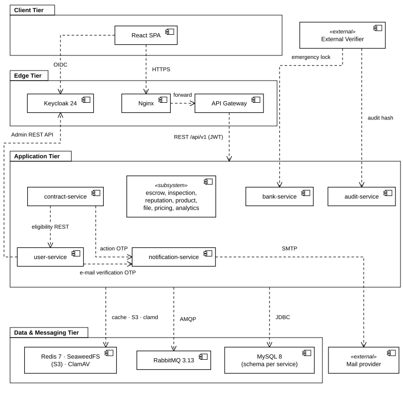

<p align="center">
  
</p>

<p align="center">
  <a href="#what-is-built">Status</a> ·
  <a href="#architecture">Architecture</a> ·
  <a href="#getting-started">Getting started</a> ·
  <a href="#testing">Testing</a> ·
  <a href="#documentation">Docs</a> ·
  <a href="CONTRIBUTING.md">Contributing</a> ·
  <a href="SECURITY.md">Security</a>
</p>

AgriContract is a B2B platform for seasonal forward contracts between Vietnamese coffee cooperatives (sellers) and purchasing organisations (buyers). Both parties sign one set of terms, money is locked in escrow per delivery batch, and every penalty or payout follows from a recorded decision, so the contract keeps both sides honest while the harvest happens rather than in court a year later.

It is a capstone project built by a team of five. The domain is real; the money is not: `bank-service` is a mock custodian with the same ledger rules a real one would need.

## The problem

Coffee forward contracts in Vietnam are signed three to six months before harvest, mostly on trust. When the market moves, breaking the deal (*bẻ kèo*) can pay better than honouring it: in 2024 Robusta went from about VND 60M to 135M per tonne. Courts take one to three years, which is longer than the goods last, and cooperatives rarely have the records to prove what was agreed.

AgriContract works at the contract layer only:

- **Terms are fixed before signing.** Both signatures (OTP-bound) cover one hash of the same terms; the signed PDF is mailed to both parties.
- **Money is locked before it is needed.** Deposits activate the contract; each delivery batch (milestone) locks its own payment before goods move.
- **Accusations cost nothing; decisions do.** Only an attribution decision, by the system or by an arbitrator, can move penalty money or touch reputation, and it waits out a two-business-day contest window first.
- **Evidence outlives the platform.** Ledger entries are append-only, audit records are hash-chained, and hashes are mailed out to the parties.

Out of scope: logistics, price discovery, accounting, real bank integration, CA-backed signatures.

## What is built

The seven business flows from the requirements (Report 3) and where each one stands. Each flow has a Bruno end-to-end collection in [`backend/bruno/e2e`](backend/bruno/e2e).

| Flow | What happens | Status |
|---|---|---|
| BF-01 Onboarding & KYC | Register, verify email by OTP, Operator approves or rejects the organisation | Built |
| BF-02 Plot & listing | Category and product, plot registry with geo check, coffee listings | Built |
| BF-03 Offer, signing, activation | Offer, negotiate, withdraw, two OTP signatures on one terms hash, deposit lock, signed PDF by mail | Built |
| BF-04 Milestone delivery & settlement | Fund, weigh, receive, confirm, dispute, Level 1.5 inspection, arbitration, pro-rata settlement, ledger and audit | Built |
| BF-05 Breach & force majeure | Breach cases from BF-04 are built; funding failure, timeout breaches, termination for breach and force majeure are in progress ([#239](https://github.com/redavocado-labs/AgriContract/issues/239), [#240](https://github.com/redavocado-labs/AgriContract/issues/240), [#242](https://github.com/redavocado-labs/AgriContract/issues/242), [#244](https://github.com/redavocado-labs/AgriContract/issues/244)) | Partial |
| BF-06 Mutual termination & replacement | Agreed termination and the supersede saga ([#242](https://github.com/redavocado-labs/AgriContract/issues/242), [#243](https://github.com/redavocado-labs/AgriContract/issues/243)) | Planned |
| BF-07 Emergency security lock | Audit chain verification is built; the External Verifier kill switch is designed ([#252](https://github.com/redavocado-labs/AgriContract/issues/252)) | Partial |

Known gaps are tracked as issues rather than hidden; see [SECURITY.md](SECURITY.md#what-is-not-done-yet) for the security ones.

## Architecture



Twelve services behind one gateway. Each service owns its MySQL schema; services talk through RabbitMQ events (choreography saga) and a few internal HTTP calls. Every event leaves through a transactional outbox, and every consumer de-duplicates on `eventId`.

| Service | Stack | Owns |
|---|---|---|
| `api-gateway` | Spring Cloud Gateway | JWT validation (Keycloak), routing, internal secret to downstream services |
| `user-service` | Spring Boot | Profiles, organisations, KYC, email OTP |
| `product-service` | Spring Boot | Categories, products, plots, listings |
| `contract-service` | Spring Boot | Contract and milestone state machines, signatures, breach cases, attribution and remedy decisions |
| `escrow-service` | Spring Boot | Escrow legs per contract and milestone; the only caller of the bank |
| `bank-service` | Spring Boot | Mock custodian: append-only ledger, balances derived from entries |
| `inspection-service` | Spring Boot | Inspector assignment, reports with content hash |
| `reputation-service` | Spring Boot | Reputation facts and locks, from `remedy.finalized` only |
| `audit-service` | Spring Boot | Hash-chained audit records, chain verification |
| `notification-service` | NestJS | Every email, with a persisted send log keyed per event and recipient |
| `file-service` | NestJS | Uploads to S3-compatible storage, ClamAV scan, inspection report intake by email |
| `pricing-service` | NestJS | External reference prices, Redis cache |
| `analytics-service` | NestJS | Platform statistics read model |

`pricing-service` and `analytics-service` are built and tested in CI but are not in the Compose stack yet.

Contract lifecycle: `OFFERED → NEGOTIATING → SIGNED → ACTIVE → SETTLED`, with terminal states `WITHDRAWN`, `TERMINATED`, `SUPERSEDED` and `ACTIVATION_FAILED`. Signing is not activation: a contract becomes `ACTIVE` only once the deposits are locked, and no contract reaches a terminal state while any money is still locked for it.

Milestone lifecycle: `CREATED → IN_PROGRESS → SELLER_WEIGHED → BUYER_RECEIVED → SETTLED`, with the dispute branch `AWAITING_SELLER_RESPONSE → CONTESTED` and `FORCE_MAJEURE_PENDING_REVIEW`. A dispute is a state of the milestone, not a separate aggregate.

Roles: `BUYER`, `SELLER`, `INSPECTOR`, `OPERATOR` (daily operations), `ARBITRATOR` (decisions with money or reputation consequences), `ADMIN` (system administration only). There is no fallback: an admin cannot act as an operator or arbitrator.

### Engineering decisions worth a look

- **Append-only ledger, balances derived.** `bank-service` writes one immutable row per lock, release, refund or penalty; balances are always sums. The bank checks the shape of one row; rules across rows (never release more than is locked) belong to escrow.
- **Idempotency key = the request's `eventId`.** RabbitMQ delivers at least once. The bank stores the request's `eventId` with a unique constraint; a duplicate writes nothing but re-sends the original confirmation, because the redelivery may mean the first confirmation was lost. Escrow retries with the *same* `eventId`, never a new one.
- **Wait for confirmation.** Escrow never marks money as locked until the bank confirms; the contract never activates until escrow confirms.
- **Terminal only after money is back.** Escrow publishes `escrow.contract_lock_cleared` once every payout of a decision is complete and the ledger shows zero locked; only then does the contract commit its terminal state.
- **Clean layers, enforced in CI.** Domain code has no framework imports; transactions live in infrastructure, behind a port the use case calls. ArchUnit (Java) and dependency-cruiser (NestJS) fail the build on a violation.
- **Reference prices from outside only.** No price is computed from the platform's own contracts, so a large buyer cannot manufacture a "market price" with a few underpriced deals.

## Getting started

Requirements: Docker with Compose v2, Node 22 (frontend) and `openssl`. Images build inside Docker, so Java and Maven are needed only to run the Java tests locally (JDK 21, Maven 3.9).

### 1. Configure

```bash
git clone https://github.com/redavocado-labs/AgriContract.git
cd AgriContract/backend
cp .env.example .env
# Every REPLACE_WITH_RANDOM_SECRET gets its own value (GNU sed):
while grep -q REPLACE_WITH_RANDOM_SECRET .env; do
  sed -i "0,/REPLACE_WITH_RANDOM_SECRET/s//$(openssl rand -hex 32)/" .env
done
```

Compose refuses to start while a required secret is missing. The Keycloak realm, its users and the login theme are imported on first start; after a realm change, re-import with `docker compose down -v`.

### 2. Run the backend

| Mode | Command | Host ports |
|---|---|---|
| Development | `docker compose up -d --build` | Gateway plus `user` 8081, `product` 8082, `contract` 8083, `escrow` 8084 and `notification` 8085 directly (from `docker-compose.override.yml`) |
| Demo | `docker compose -f docker-compose.yml up -d --build` | Everything through the gateway on 8080; no per-service ports |

The first build takes several minutes. Then load the seed data:

```bash
bash scripts/dev-seed.sh
```

| URL | What |
|---|---|
| http://localhost:8080 | API gateway |
| http://localhost:8180 | Keycloak (admin console with `KEYCLOAK_ADMIN` from `.env`) |
| http://localhost:8025 | MailHog: every email the platform sends, OTPs included |
| http://localhost:15672 | RabbitMQ management |

### 3. Run the frontend

```bash
cd ../frontend
cp .env.example .env
npm ci
npm run dev        # http://localhost:5173, talks to the gateway on 8080
```

### Seed accounts

All passwords are `pass123` (local only).

| User | Role |
|---|---|
| `buyer1` | BUYER |
| `seller1`, `seller2` | SELLER |
| `inspector1` | INSPECTOR |
| `operator1` | OPERATOR |
| `arbitrator1` | ARBITRATOR |
| `admin1` | ADMIN |

## Testing

| Level | Where | Run |
|---|---|---|
| Unit and integration (Java) | `backend/*/src/test`, Testcontainers MySQL/RabbitMQ | `mvn -pl <service> -am verify` from `backend/` |
| Unit, contract and integration (NestJS) | `backend/<node-service>` | `npm test`, `npm run test:int`, `npm run arch` |
| Event and API contracts | `contracts/**` checked from both sides | part of each service's suite |
| End to end, all seven flows | `backend/bruno/e2e` | `backend/scripts/run-e2e-full.sh --fresh --keep` |
| Golden flow on a fresh stack | `backend/e2e` | GitHub Actions `E2E` workflow |
| Frontend | `frontend/tests` | `npm test`, `npm run test:e2e` (Playwright) |

CI runs only the jobs whose paths changed, and `ci-gate` must be green before a merge. Test reports and the defect log are in [`docs/reports`](docs/reports) (Report 5.x).

## Documentation

| What | Where |
|---|---|
| Requirements and design reports (Report 1–5) | [`docs/reports`](docs/reports) |
| Design per service, source of truth | [`docs/design`](docs/design) |
| Frozen REST and event contracts | [`contracts/openapi`](contracts/openapi), [`contracts/events`](contracts/events) |
| State machines, error catalogue, integration map | [`docs/contracts`](docs/contracts) |
| E2E case catalogue | [`backend/bruno/e2e/README.md`](backend/bruno/e2e/README.md) |

## Team

| Member | Area |
|---|---|
| [@RedAvocado22](https://github.com/RedAvocado22) | Lead; contract, escrow, bank and audit services; review and merge |
| [@LetMeSoloSir](https://github.com/LetMeSoloSir) | User and product services, gateway |
| [@Emperor294](https://github.com/Emperor294) | Inspection and reputation services |
| [@viethung82nd](https://github.com/viethung82nd) | Notification service (NestJS) |
| [@minhlphe171115](https://github.com/minhlphe171115) | Pricing and analytics services |

## License

[PolyForm Noncommercial 1.0.0](LICENSE). You may read, study, run, modify and demo AgriContract for any noncommercial purpose: personal use, learning, research, teaching, and use by schools, charities and public bodies.

Commercial use, such as running it for a business or building it into a paid product or service, needs a separate license from the authors. Open an issue or contact [@RedAvocado22](https://github.com/RedAvocado22) to ask.
